


 

 

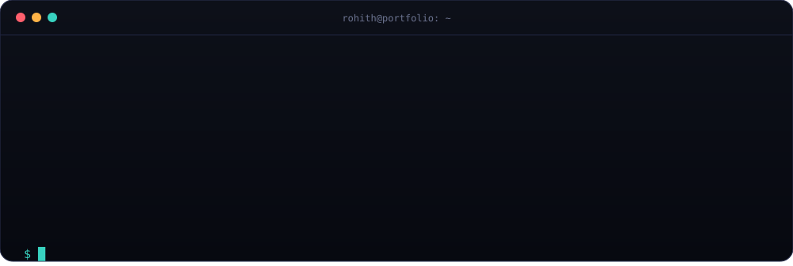

 


 


 

<a href="https://github.com/rohithvandadi07-ux/patient-aware-cyber-resilience"></a>
<a href="https://github.com/rohithvandadi07-ux/AEGIS"></a>
<a href="https://github.com/rohithvandadi07-ux/ai-phishing-detection-system"></a>
<a href="https://github.com/rohithvandadi07-ux/vendorguard"></a>
<a href="https://github.com/rohithvandadi07-ux/deepfake-detection"></a>
<a href="https://github.com/rohithvandadi07-ux/LexMind-AI"></a>

 

| Project | What it does | Stack |
|---|---|---|
| [Detectra](https://github.com/rohithvandadi07-ux/Detectra-) | Automated security layer for ROS 2 systems | ROS 2, Python |
| [ROS 2 Object Scanner](https://github.com/rohithvandadi07-ux/ros2_object_scanner) | 3D object reconstruction in a ROS 2 Jazzy simulation | ROS 2, Python, Gazebo |
| [Accident Detection](https://github.com/rohithvandadi07-ux/accident-detection) | Real-time accident detection from images and video | YOLOv8, OpenCV, Streamlit |
| [AI Resume Analyzer](https://github.com/rohithvandadi07-ux/ai-resume-analyzer) | Scores resumes, finds skill gaps, suggests ATS improvements | Groq, LLaMA 3, PyPDF2 |
| [Checkout Recovery Agent](https://github.com/rohithvandadi07-ux/checkout-recovery-agent) | AI-powered checkout drop-off recovery agent | Python |
| [EcoTrace AI](https://github.com/rohithvandadi07-ux/ecotrace-ai) | Carbon footprint tracker with a Gemini AI advisor | JavaScript, Chart.js, Gemini API |
| [AI Chatbot](https://github.com/rohithvandadi07-ux/ai-chatbot) | Chatbot with memory and multiple personalities | Python, LangChain, Streamlit |
| [Image Caption Generator](https://github.com/rohithvandadi07-ux/image-caption-generator) | Natural language descriptions for images | BLIP, HuggingFace, PyTorch |
| [Disease Prediction](https://github.com/rohithvandadi07-ux/disease-prediction) | Disease prediction from symptoms | Random Forest, Groq, Streamlit |
| [Prompt Wars Challenge 4](https://github.com/rohithvandadi07-ux/prompt-wars-challenge-4) | Web project, [live demo](https://prompt-wars-challenge-4-seven.vercel.app) | JavaScript |
| [Digital Twin Adaptive MPC](https://github.com/rohithvandadi07-ux/control_systems) | Digital-twin-driven adaptive model predictive control for EV battery fast charging | Python |
| [Battery Digital Twin](https://github.com/rohithvandadi07-ux/Battery-Digital-Twin) | Battery health and remaining-useful-life framework (TCN-LSTM, EKF, ECM) | MATLAB, Simulink |

 


 

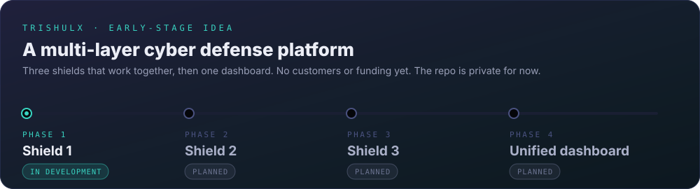

 


 

I am looking for internships and placement roles in AI/ML, cybersecurity and full-stack, and I take on freelance projects. If you are a mentor, incubator or founder who wants to talk about TrishulX, or you work in AI or security and have feedback on anything above, I would love to hear from you.

